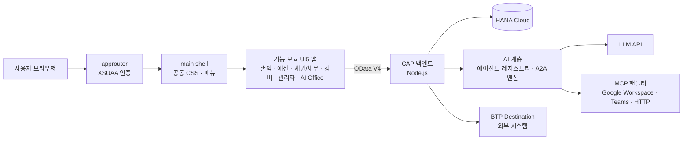

# SAP BTP Enterprise Portal — 개발 포트폴리오

SAP BTP(Cloud Foundry) 위에서 운영 중인 **사내 통합 업무 포털**을 개발하며 설계·구현한 내용을 정리한 저장소입니다.
회사 코드를 그대로 옮기지 않고, 제가 맡은 영역의 **구조·설계 판단·핵심 패턴**을 일반화한 문서와 샘플 코드로 재구성했습니다.

> 회사명·고객사·도메인 주소·계정·키·실데이터는 모두 제거했습니다. 샘플 코드는 원본 로직의 패턴을 살려 새로 작성한 것입니다.

---

## 한눈에 보기

| 항목 | 내용 |
|---|---|
| 플랫폼 | SAP BTP · Cloud Foundry · SAP Business Application Studio |
| 프론트엔드 | SAPUI5 (XML View · OData V4 · sap.f Card · VizFrame) |
| 백엔드 | SAP CAP (Node.js) · CDS · SAP HANA Cloud |
| 배포 | MTA (mbt) · approuter · XSUAA · Destination |
| AI | Gemini API · 에이전트 레지스트리 · A2A(Agent-to-Agent) 워크플로 · MCP 도구 핸들러 |
| 규모 | 기능 모듈 13개 · UI5 앱 약 200개 · CAP 서비스 약 150개 · CDS 엔티티 파일 약 150개 |

## 시스템 구성



자세한 내용은 [docs/architecture.md](docs/architecture.md)에 있습니다.

## 맡은 일과 주요 성과

**1. 업무 도메인 개발 (손익 · 예산 · 채권/채무 · 경비)**
- 손익(P&L) 매트릭스·KPI·조기경보, 예산 편성·집행·승인, 매입계약·매입채무(AP)·채권, 경비 결재 화면과 CAP 서비스 구현
- 설계서 대비 갭 분석 → AS-IS/TO-BE 정리 → 구현 → 브라우저 시나리오 테스트(최대 300개 점검 항목)까지 전 과정 수행

**2. 권한 시스템 재설계**
- Role Collection → 허용 조직 매핑 → **하위 부서 자동 전개** → 서버 측 조회·쓰기 강제의 4단계 권한 모델 설계
- 화면이 보낸 조직값을 그대로 믿지 않고 사용자 권한과 교집합으로 깎는 방식으로 무권한 데이터 노출 차단
- 개인정보(계좌·주소) 조회 결과 마스킹, 버튼 단위 권한 공용 유틸 구축 → [samples/cap-authz](samples/cap-authz), [samples/cap-pii-mask](samples/cap-pii-mask)

**3. AI 업무 플랫폼**
- 도메인별 **에이전트 레지스트리**(도구명 = CAP 액션명 계약)로 손익·예산·경비·채권채무 AI를 같은 구조로 통일
- 화면 «자리(Slot)» 카탈로그로 *어느 카드에 어느 에이전트가 답하는지*를 데이터로 관리
- A2A 워크플로 16종 등록·검증, MCP 도구 핸들러(메일·문서·캘린더·Teams·범용 HTTP·AI 추출) 레지스트리 설계
- → [docs/ai-agent-platform.md](docs/ai-agent-platform.md), [samples/cap-agent-registry](samples/cap-agent-registry), [samples/cap-mcp-handlers](samples/cap-mcp-handlers)

**4. 프론트엔드 표준화**
- 3단계 CSS 구조(전역 → 앱 → 페이지)와 유틸 클래스 조합 원칙으로 디자인 시스템 정리, Figma → UI5 매핑 표 작성
- 프래그먼트 + 전용 컨트롤러 1:1 패턴, 공용 포매터 우선 원칙 등 팀 코딩 규칙 문서화 → [docs/conventions.md](docs/conventions.md)

**5. AI 페어 프로그래밍 운영**
- BAS 안에서 Claude Code를 상시 운영하며 규칙 문서(CLAUDE.md)·작업 저널·체크포인트 기반으로 장시간 자율 작업을 관리
- "추정 금지, 실측 확인" 원칙과 로컬(cds watch) ↔ 배포본 검증 구분을 규칙화

## 저장소 구성

```
docs/
  architecture.md        시스템 구조 · 모듈 · 개발/배포 흐름
  ai-agent-platform.md   AI 에이전트 · 화면 자리 · A2A · MCP 설계
  conventions.md         UI5/CAP 코딩 규칙과 디자인 시스템
samples/
  cap-authz/             조직 범위 권한 판정·조회 필터
  cap-pii-mask/          개인정보 칸 마스킹 (after READ 훅)
  cap-agent-registry/    도메인 에이전트 레지스트리 + 프롬프트 호출 단일 경로
  cap-mcp-handlers/      MCP 도구 핸들러 레지스트리
  cap-llm-json/          LLM "텍스트 → 스키마 JSON" 래퍼
  ui5-fragment-pattern/  프래그먼트 + 전용 컨트롤러 지연 로딩
  ui5-formatter/         공용 포매터 (천단위·날짜)
  mta/                   멀티 모듈 MTA 배포 디스크립터 예시
worklog/                 월별 작업 기록
```

## 작업 기록

[worklog/](worklog/)에 월별로 무엇을, 왜, 어떻게 했는지 정리하고 있습니다.
