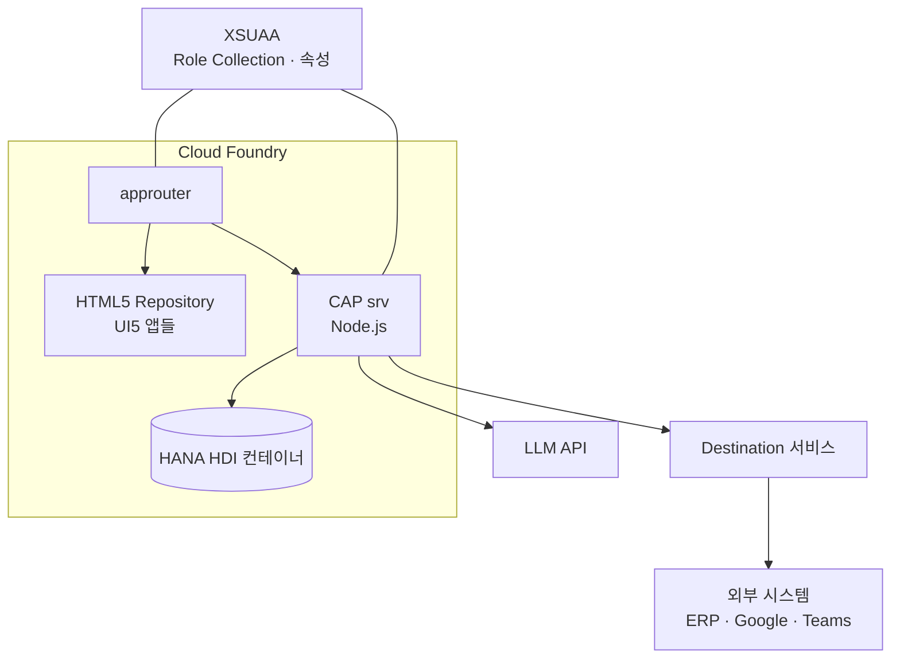
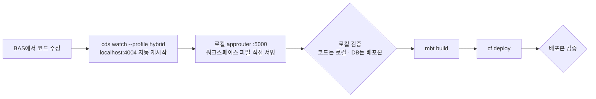

# 시스템 아키텍처

## 1. 개요

여러 업무 도메인을 하나의 포털 셸 아래에 모은 **멀티 모듈 SAP BTP 애플리케이션**입니다.
각 기능 모듈은 독립된 MTA로 빌드·배포되고, 공통 셸(main)과 공용 라이브러리(lib)를 통해 하나의 포털처럼 동작합니다.

## 2. 모듈 구성

| 모듈 | 역할 | 규모(대략) |
|---|---|---|
| `main` | 포털 셸, approuter 호스트, **전역 CSS 디자인 시스템** | 셸 1 |
| `lib` | 공용 UI5 라이브러리 (포매터·공용 프래그먼트·홈 위젯·BPMN 뷰어) | 라이브러리 1 |
| `cap` | CAP 백엔드 — 전 모듈의 OData V4 서비스, DB 스키마, AI 계층 | 서비스 약 150 |
| `admin` | 사용자·조직·권한·메뉴·로그 관리 | 앱 약 35 |
| `bix` | 손익(P&L) 매트릭스·대시보드·AI 리포트 | 앱 약 10 |
| `budget` | 예산 편성·집행·승인·리포트 | 앱 약 11 |
| `contract` | 매입계약·매입채무·채권·자금·Agentic 콘솔 | 앱 약 28 |
| `cost` | 경비·법인카드·출장·자산 | 앱 약 55 |
| `office` | AI Office (주문·출하·재고·구매 업무 자동화) | 앱 약 25 |
| `card` | 홈 화면 카드 위젯 (sap.f Card) | 카드 약 40 |
| `electronicPayment` | 전자결재 | 앱 5 |
| `utils` | 공용 화면 조각 (폼·테이블·레이아웃·피드백) | 앱 5 |

## 3. 런타임 구조



- **인증/인가**: approuter가 XSUAA로 로그인을 처리하고, CAP은 토큰의 Role Collection과 사용자 속성으로 권한을 판정합니다.
- **권한 데이터**: "Role Collection → 허용 조직" 매핑은 관리자 화면에서 관리하는 DB 테이블에 두고, 판정은 서버에서만 합니다. ([samples/cap-authz](../samples/cap-authz))
- **외부 연동**: 외부 시스템 주소와 인증은 BTP Destination이 가지고, 코드는 Destination 이름만 압니다.

## 4. 백엔드 구조 (CAP)

```
cap/
  db/            CDS 엔티티 (도메인별 .cds) · 시퀀스 · 시드
  srv/
    *.cds        서비스 정의 (도메인별)
    *.js         서비스 핸들러
    lib/         도메인 무관 공용 로직 — 권한, 결재 엔진, 채번, 개인정보 마스킹, 입력 검증, LLM 래퍼
    office/      AI Office 업무 로직 (주문·출하·재고·청구 …)
    officeAgents/ plAgents/  도메인별 AI 에이전트 레지스트리
    a2a/         A2A 워크플로 엔진 (결정 노드 · API 노드 · 실행 로그 · 봇 리포트)
    mcpHandlers/ 외부 도구 실행 핸들러
```

설계 원칙
- **서비스 핸들러는 얇게, 규칙은 `lib/`에** — 권한·결재·채번처럼 여러 도메인이 같이 쓰는 규칙은 한 벌만 둡니다.
- **서버가 최종 판정** — 화면이 보낸 조직 코드·버튼 상태를 믿지 않고 서버 훅(before/after)에서 다시 거릅니다.
- **요청 단위 캐시** — 권한 계산처럼 한 요청에서 여러 번 쓰는 값은 `req`에 Promise로 먼저 캐시해 병렬 훅에서도 한 번만 계산합니다.

## 5. 개발 · 검증 · 배포 흐름



- 하이브리드 프로필로 **로컬 코드 × 배포 DB** 조합에서 먼저 확인하고, 스키마 변경과 배포는 사람이 직접 실행합니다.
- 보고할 때는 "로컬에서 확인"과 "배포본에서 확인"을 반드시 구분합니다.
- 스키마 배포가 늦어져도 깨지지 않도록, 새 컬럼을 읽는 코드는 컬럼이 없을 때도 기본값으로 동작하게 작성합니다.

## 6. 프론트엔드 구조

- 각 기능 모듈 = 여러 UI5 앱. 앱마다 `webapp/` 아래 `view`, `controller`, `fragment`, `model`.
- 공통 CSS는 **main 모듈 한 곳**에만 둡니다 (`css/style.css` → 앱별 → 페이지별 3단계, [conventions.md](conventions.md)).
- 데이터 접근은 OData V4 모델과 `$batch`(submitBatch)를 기본으로 하고, LLM 호출처럼 오래 걸리는 비 OData 요청만 비동기 `fetch`를 씁니다.
