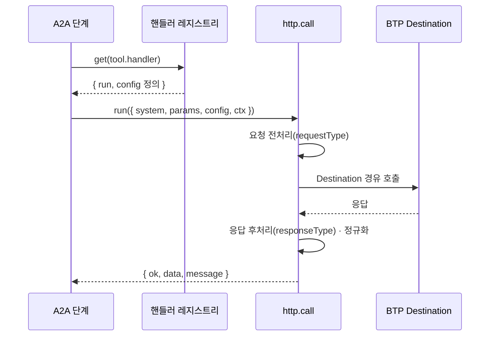

# MCP 도구 핸들러 레지스트리 (CAP)

A2A 워크플로와 AI 어시스턴트가 외부 시스템(메일, 문서, 캘린더, 메신저, 임의의 REST API)을 호출할 때 쓰는 **실행 핸들러 목록**입니다.
`index.js`만 포함했고, 각 핸들러 구현(`handlers/*`)은 이 저장소에서 뺐습니다.

## 실행 흐름

## 설계 포인트
- **명시적 레지스트리**: 화면에 라벨·파라미터·스코프를 함께 내려주고, 내부 함수가 도구로 새어 나가지 않게 합니다.
- **하나의 시그니처**: 모든 핸들러가 같은 입출력 모양이라 워크플로 엔진은 핸들러 종류를 몰라도 됩니다.
- **변환기로 흡수**: 범용 HTTP 핸들러에 요청/응답 변환기 이름만 지정하면, 대부분의 시스템은 전용 핸들러 없이 연결됩니다.
- **Destination 필요 여부는 핸들러가 결정**: API마다 호스트가 다르거나 자체 토큰을 쓰는 서비스가 있기 때문입니다.
- **`noBind` 인자**: 앞 단계 결과로 채우면 안 되는 *설정성* 인자를 표시합니다. 본문이 통째로 스키마 칸에 들어가 망가진 실제 사례가 있었습니다.
